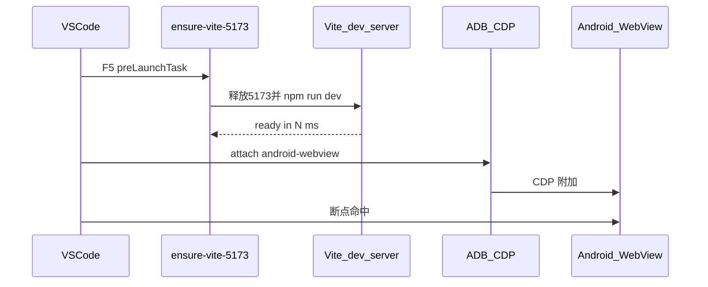

# AssistsX Vue 入门模板

**AssistsX 插件的 Vue 3 + Vite + TypeScript 入门工程**，用于在 Android WebView 中运行自动化脚本 UI，配合 `assistsx-js` 做无障碍节点操作与步骤流（`StepImpl`）开发。

技术栈：Vue 3、Vue Router、Vite 8、TypeScript、`assistsx-js`。

## 功能说明

| 模块 | 路径 | 说明 |
|------|------|------|
| 插件元数据 | `public/config.json` | 名称、包名、入口 `index.html`、图标等，供 AssistsX 宿主加载 |
| 首页与浮窗 | `src/views/HomePage.vue` | 演示 `float.open()` 打开日志/测试面板 |
| 日志面板 | `src/views/LogPanel.vue` | 运行时日志展示示例 |
| 测试面板 | `src/views/TestFloatPanel.vue` | 触发抖音未读检查等测试入口 |
| 自动化步骤 | `src/steps/` | 经典 `StepImpl` 示例（`app-launch.ts`、`douyin-main.ts`） |
| 本地/npm 切换 | `assistsx-resolve.mjs`、`.env.example` | 开发时可指向本地 `assistsx-js` 源码联调 |
| API 文档 | Assists MCP | 通过 `search_assistsx_js_docs` / 文档 Resource 查阅 assistsx-js 开发文档 |
| VS Code 调试 | `vscode/`（生成后 → `.vscode/`） | Android WebView 断点调试配置，见下文 |

## 目录结构

```
.
├── public/
│   ├── config.json       # AssistsX 插件配置
│   └── icon.png          # 插件图标
├── src/
│   ├── steps/            # 自动化步骤（业务主入口）
│   ├── views/            # Vue 页面与浮窗
│   ├── router/           # 路由
│   └── config/           # 环境相关配置
├── vscode/               # 脚手架生成后自动重命名为 .vscode/
├── scripts/              # assistsx-js tsconfig 同步等
├── assistsx-resolve.mjs  # 本地 / npm assistsx-js 解析
├── .env.example          # 本地调试库环境变量示例（复制为 .env.local）
├── vite.config.js        # 已配置 host 0.0.0.0:5173，便于手机访问
└── package.json
```

## 快速开始

```bash
npm install
npm run dev
```

| 命令 | 说明 |
|------|------|
| `npm run dev` | 启动开发服务器（默认 `http://0.0.0.0:5173`） |
| `npm run build` | 生产构建，输出到 `dist/` |
| `npm run preview` | 预览构建产物 |
| `npm run typecheck` | TypeScript 类型检查 |
| `npm run dev:registry` | 强制使用 npm 包中的 assistsx-js |
| `npm run sync:assistsx-tsconfig` | 生成 `.tsconfig-assistsx.json`（postinstall 会自动执行） |

## AssistsX 插件配置

插件元数据位于 [`public/config.json`](public/config.json)，打包时使用 [`public/icon.png`](public/icon.png) 作为图标。创建项目后请按需修改：

| 字段 | 说明 |
|------|------|
| `name` | 插件显示名称 |
| `versionName` / `versionCode` | 版本号 |
| `description` | 插件描述 |
| `packageName` | Android 包名，需唯一（如 `com.example.assistsx.vue.starter`） |
| `index` | WebView 入口 HTML，默认 `index.html` |
| `indexInOverlay` | 是否在悬浮层中加载入口 |
| `icon` | 图标文件名，对应 `public/` 下资源 |
| `sourceUrl` | 可选远程源码地址 |

## assistsx-js：本地源码 vs npm

API 与开发文档请通过 **Assists MCP**（`search_assistsx_js_docs` → 按需 `resources/read`）查阅，无需再把 SDK 源码下载到项目里。

模板同时支持在开发时**联调本地 `assistsx-js` 源码**（改 SDK 即时生效、可断点），或**使用 `node_modules` 中的 npm 包**。解析逻辑集中在 [`assistsx-resolve.mjs`](assistsx-resolve.mjs)，Vite 与 TypeScript 共用同一套规则。

### 环境变量（`.env.example`）

复制 [`.env.example`](.env.example) 为 **`.env.local`**（已被 git 忽略，适合本机私有路径）：

```bash
cp .env.example .env.local
```

| 变量 | 说明 |
|------|------|
| `ASSISTSX_JS_LOCAL` | 本地 `assistsx-js` **仓库根目录**的绝对路径；解析入口为 `<根>/src/index.ts` |
| `ASSISTSX_USE_NPM` | 设为 `1` 时**强制**使用 `node_modules` 中的包，忽略本地源码 |

**读取优先级**：`process.env`（命令行临时注入）> `.env.local` / `.env`（Vite `loadEnv`）> 默认路径。

**默认路径**：未设置 `ASSISTSX_JS_LOCAL` 时，尝试项目**上一级**的同级目录 `../assistsx-js`（需存在 `src/index.ts`）。

`.env.local` 示例：

```bash
# 本地 assistsx-js 不在 ../assistsx-js 时，填写绝对路径
ASSISTSX_JS_LOCAL=/Users/you/projects/assistsx-js

# 临时切回 npm 包（也可直接用 npm run dev:registry）
# ASSISTSX_USE_NPM=1
```

### 解析规则

满足以下**全部**条件时，Vite / TypeScript 走本地源码：

1. `ASSISTSX_USE_NPM` 不为 `1`
2. 本地入口 `<assistsx-js根>/src/index.ts` 存在

否则回退到 `node_modules/assistsx-js`。

本地模式下 Vite 会：

- 将 `import 'assistsx-js'` 别名到本地 `src/index.ts`
- 将 `import 'assistsx-js/step-flow'` 别名到本地 `src/step-flow/index.ts`
- 在 `server.fs.allow` 中放行本地仓库目录（便于 HMR）

TypeScript 通过 `npm run sync:assistsx-tsconfig` 生成 [`.tsconfig-assistsx.json`](.tsconfig-assistsx.json)（`postinstall` 会自动执行）：优先指向本地 `dist/index.d.ts` 做类型检查；若尚未 build 本地库，会回退到 `src/index.ts` 并提示先在 assistsx-js 目录执行 `npm run build`。

### 推荐目录布局（同级仓库）

```
projects/
├── assistsx-js/          # SDK 源码
│   └── src/index.ts
└── my-assistsx-plugin/   # 本模板生成的项目
    ├── .env.local        # 可选：ASSISTSX_JS_LOCAL=../assistsx-js
    └── src/
```

若已是上述布局，**无需配置 `.env.local`**，直接 `npm run dev` 即可自动联调。

### 常用命令

| 命令 | 说明 |
|------|------|
| `npm run dev` | 有本地 assistsx-js 时用本地源码，否则用 npm 包 |
| `npm run dev:registry` | 强制使用 npm 包（等价于 `ASSISTSX_USE_NPM=1`） |
| `npm run sync:assistsx-tsconfig` | 按当前环境重新生成 `.tsconfig-assistsx.json` |
| `npm run typecheck` | 类型检查（会先 sync tsconfig） |

修改 `.env.local` 后，建议重新执行 `npm run sync:assistsx-tsconfig` 或重启 `npm run dev`，确保 Vite 与 TS 路径一致。

### 典型场景

| 场景 | 做法 |
|------|------|
| 只用 npm 包（默认） | 不设 `ASSISTSX_JS_LOCAL`，且不存在 `../assistsx-js/src/index.ts` |
| 同级联调 assistsx-js | 将 assistsx-js clone 到项目上一级，直接 `npm run dev` |
| assistsx-js 在其他路径 | `.env.local` 设置 `ASSISTSX_JS_LOCAL=/绝对路径/assistsx-js` |
| 本地与 npm 切换对比 | 平时 `npm run dev`；对比行为时用 `npm run dev:registry` |
| 联调 SDK 时类型报错 | 在 assistsx-js 目录先 `npm run build`，再在本项目 `npm run sync:assistsx-tsconfig` |
| 查阅 API / 开发文档 | 使用 Assists MCP 的 `search_assistsx_js_docs` |

### 与 VS Code 断点调试配合

开启 [Android WebView 断点调试](#android-webview-断点调试-vs-code--cursor) 时，若已走本地 assistsx-js：

- 可在**本项目**的 `src/` 与**本地 assistsx-js** 的 `src/` 中同时设断点
- 确保 F5 启动的 Vite 日志出现 `[vite] assistsx-js：使用本地源码（根=...）`
- 本地库源码变更会触发热更新；改类型定义后需在 assistsx-js 重新 build 并 sync tsconfig

若调试时只想验证已发布 npm 包行为，使用 `npm run dev:registry` 或在 `.env.local` 中设置 `ASSISTSX_USE_NPM=1`。

## 示例路由与步骤

| 路径 | 说明 |
|------|------|
| `/` | 首页，可打开浮窗示例 |
| `/examples/log-panel` | 日志面板（浮动或内嵌） |
| `/examples/test-panel` | 测试面板，点击「检查抖音未读消息」触发自动化 |

测试面板（`TestFloatPanel.vue`）会通过 `Step.run()` 调用 `src/steps/app-launch.ts` 启动抖音，并在 `src/steps/douyin-main.ts` 中执行未读消息检查流程；日志输出可在日志面板查看。

请将首页与 `src/steps/` 替换为您的业务逻辑。

## Android WebView 断点调试（VS Code / Cursor）

本模板内置 Android WebView 调试配置。通过 `create-assistsx-vue` 创建项目时，模板中的 `vscode/` 会自动重命名为 `.vscode/`，包含 `launch.json`、`tasks.json`、`extensions.json`。

### 调试流程



### 内置配置文件

| 文件 | 作用 |
|------|------|
| `launch.json` | `android-webview` attach；`preLaunchTask: ensure-vite-5173`；`urlFilter: http://*:5173/*`；`vueComponentPaths` 支持 `.vue` 断点 |
| `tasks.json` | 释放 5173 端口并后台启动 Vite（`npm run dev -- --host 0.0.0.0 --port 5173`） |
| `extensions.json` | 推荐 `mpotthoff.vscode-android-webview-debug`、`Vue.volar` |

### 前置条件

1. **编辑器**：[Visual Studio Code](https://code.visualstudio.com/) 或 [Cursor](https://cursor.com/)（需内置 JavaScript 调试器，即 [vscode-js-debug](https://github.com/microsoft/vscode-js-debug)）。
2. **必装扩展**：[Android WebView Debugging](https://marketplace.visualstudio.com/items?itemName=mpotthoff.vscode-android-webview-debug)（`mpotthoff.vscode-android-webview-debug`）；建议同时安装 [Vue (Official)](https://marketplace.visualstudio.com/items?itemName=Vue.volar)。
3. **本机环境**：已安装 ADB 且 `adb` 在 `PATH` 中；macOS / Linux 下 `tasks.json` 使用 `lsof` 与 `kill` 释放 5173 端口。
4. **设备与 App**：手机/模拟器开启 USB 或无线调试（`adb devices` 可见）；App 内 WebView 调用 `WebView.setWebContentsDebuggingEnabled(true)`（一般仅 Debug 包或受控环境开启）。
5. **访问地址**：手机 WebView 打开 **`http://<电脑局域网 IP>:5173/`**（Vite 已配置 `host: 0.0.0.0`、`port: 5173`；不要用 `127.0.0.1`）。

### 使用步骤

1. 用 VS Code / Cursor 打开项目，按提示安装**工作区推荐扩展**。
2. USB 或无线 ADB 连接设备，确认 `adb devices` 可见目标设备。
3. 打开**运行和调试**面板，选择 **「Android WebView: Vite 5173 (auto dev server + attach)」**。
4. 按 **F5**：先执行 `ensure-vite-5173`（释放 5173 端口并启动 Vite），再附加到匹配 `http://*:5173/*` 的 WebView。
5. 在手机上用 WebView 打开 Vite 终端里 Network 地址（`http://<局域网 IP>:5173/`）。
6. 在 `.ts` / `.vue` 中设断点；若存在多个 WebView，按扩展提示选择目标。
7. 可用桌面 Chrome 打开 `chrome://inspect/#devices` 确认 WebView 已列出且可调试。

### 可调整项

| 配置项 | 位置 | 说明 |
|--------|------|------|
| `urlFilter` | `launch.json` | 匹配 WebView URL，默认 `http://*:5173/*`；改端口需同步改 tasks |
| 端口 5173 | `tasks.json` + `vite.config.js` + `launch.json` | 三处保持一致 |
| `vueComponentPaths` | `launch.json` | Vue 单文件断点路径；非 Vue 项目可删除 |
| `webRoot` | `launch.json` | 源码根目录，默认 `${workspaceFolder}` |
| `android-webview-debug.adbPath` | VS Code 设置 | 自定义本机 ADB 可执行文件路径 |

### Windows 适配

`tasks.json` 中 `ensure-vite-5173` 为类 Unix 写法（`lsof` / `kill`）。Windows 请将 `command` 替换为适合本机 shell 的写法，例如：

```json
"command": "npx --yes kill-port 5173 & npm run dev -- --host 0.0.0.0 --port 5173"
```

`problemMatcher` 的 `endsPattern` 需仍能匹配你当前 Vite 版本终端里「已就绪」的那一行（默认匹配 `ready in 数字 ms`）。

### 常见问题

| 现象 | 处理 |
|------|------|
| 找不到 ADB | 安装 Android 平台工具，或在设置中配置 `android-webview-debug.adbPath` |
| No WebViews found | 确认 `setWebContentsDebuggingEnabled`、ADB 连接、页面已加载；用 `chrome://inspect/#devices` 排查 |
| 断点不生效 / 对不上源文件 | 确认 `webRoot` 为项目根；Vite 开发模式默认有 sourcemap |
| preLaunchTask 一直不结束 | Vite 就绪日志与 `tasks.json` 中 `endsPattern` 不一致；对照本机 Vite 输出调整 |
| 多页面 / 多包名 | 按扩展提示选择目标 WebView |
